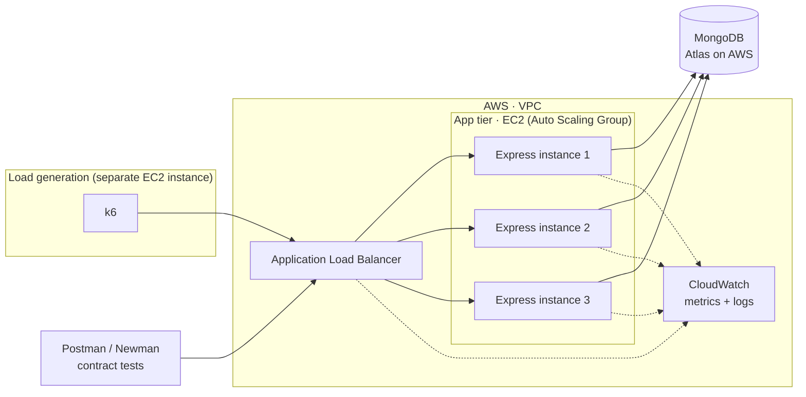

# Loadstar

> A learning project about how backends behave under real traffic.

Loadstar serves a large seeded dataset through a **deliberately simple REST API**, puts it behind a load
balancer on AWS, and then answers concrete questions **with data** instead of guesses.

The API is intentionally boring. The interesting part is what happens to it at 10, 100 and 1,000 requests
per second, and why.

---

## Why this project exists

Most backend tutorials stop at "it works on localhost." This one starts there and asks what happens next:

- What breaks first when traffic goes up: the app, the database, or the network?
- Do common practices like indexes, cursor pagination, caching and horizontal scaling help as much as people say?
- How do you *measure* that instead of assuming it?

Every experiment follows the same loop: **question → hypothesis → experiment → numbers → what I learned.**

> 🧭 **Learning project.** I'm learning AWS, load balancing and load testing as I build this. The README
> doubles as a lab notebook, so mistakes and wrong hypotheses stay in on purpose.

---

## Architecture -> AWS & Loader Project

System Design for Loader 



**Key design choice:** k6 runs on its **own** machine. If the load generator shares CPU with the API,
the numbers measure the load generator, not the API.

---

## Tech stack

| Layer | Tool | Why |
|---|---|---|
| API | **Node.js + Express** | Simple, familiar; keeps the focus on behavior, not framework features |
| Database | **MongoDB** (Atlas, hosted on AWS) | Document data, easy to seed at scale, good explain/profiler tooling |
| Compute | **AWS EC2** | Full control over instance size and count, which is what the scaling experiments need |
| Load balancing | **AWS Application Load Balancer (ALB)** | Distributes traffic across instances, runs health checks |
| Scaling | **EC2 Auto Scaling Group** | Change instance count for Q3 without rebuilding anything |
| Observability | **AWS CloudWatch** | CPU, request count, target response time, logs |
| Load testing | **k6** | Scriptable load in JavaScript, reports p95/p99, thresholds that fail the run |
| Contract testing | **Postman + Newman** | Proves the API is *correct* before measuring if it's *fast* |
| Local dev | **Docker Compose** | Run API + MongoDB locally with one command |
| CI | **GitHub Actions** | Lint, tests and Newman contract tests on every PR |

### Why both Postman and k6?

They answer different questions:

- **Postman/Newman → "Is it correct?"** Status codes, response shapes, pagination links, edge cases.
- **k6 → "How does it behave under load?"** Throughput, latency percentiles, error rates.

Postman's built-in performance runner is useful for quick sanity checks, but k6 is the source of truth
for the experiments.

---

## The data

A seeded e-commerce style dataset, chosen because it supports filtering, sorting, pagination and
aggregation:

| Collection | Size (default) | Notes |
|---|---|---|
| `products` | 1,000,000 | name, category, price, rating, createdAt |
| `reviews` | 5,000,000 | productId, rating, body, createdAt |

Generated with Faker using a **fixed seed**, so every run produces the same dataset and results are
reproducible. Sizes are configurable:

```bash
npm run seed -- --products 100000 --reviews 500000
```

---

## API

Deliberately small. Each endpoint exists to support at least one question.

| Method | Endpoint | Purpose | Used by |
|---|---|---|---|
| `GET` | `/health` | Load balancer health check | ALB |
| `GET` | `/products?page=&limit=` | **Offset** pagination (`skip/limit`) | Q1, Q5 |
| `GET` | `/products/cursor?after=&limit=` | **Cursor** pagination (by `_id`) | Q1, Q5 |
| `GET` | `/products/search?category=&minPrice=` | Filtered query (indexed vs not) | Q2 |
| `GET` | `/products/:id` | Single document lookup | Q3, Q4, Q6 |
| `GET` | `/products/:id/reviews?after=&limit=` | Paginated child collection | Q1 |
| `GET` | `/stats/categories` | Aggregation pipeline | Stretch |

### Pagination: the two approaches being compared

**Offset (`skip/limit`)**: simple and supports "jump to page N", but MongoDB still walks past every
skipped document.

```http
GET /products?page=500&limit=20
```

**Cursor (keyset)**: returns a `nextCursor`; the next query starts right after the last seen `_id`.
It can't jump to an arbitrary page, but cost shouldn't grow with depth.

```http
GET /products/cursor?after=6530f1c2a9e4b0d1f2c3a4b5&limit=20
```

```json
{
  "data": [ ... ],
  "nextCursor": "6530f1c2a9e4b0d1f2c3a4c9",
  "hasMore": true
}
```

Q1 measures whether that theory holds and *where* the crossover is.

---

## Getting started (local)

### Prerequisites

- Node.js 20+
- Docker + Docker Compose
- [k6](https://grafana.com/docs/k6/latest/set-up/install-k6/)
- Postman (optional: Newman CLI for running collections headless)

### Run it

```bash
git clone https://github.com/<your-username>/loadstar.git
cd loadstar
cp .env.example .env

docker compose up -d          # starts MongoDB (and the API, if you prefer containers)
npm ci
npm run seed                  # seeds the default dataset
npm run dev                   # API on http://localhost:3000
```

### Environment variables

| Variable | Example | Purpose |
|---|---|---|
| `PORT` | `3000` | API port |
| `MONGODB_URI` | `mongodb://localhost:27017/loadstar` | Connection string (Atlas URI in AWS) |
| `MONGO_MAX_POOL_SIZE` | `10` | Connection pool size (varied in Q4) |
| `NODE_ENV` | `development` | Environment |

Never commit `.env`. In AWS, secrets come from the environment or AWS Systems Manager Parameter Store.

---

## Testing

### Contract tests (Postman → Newman)

Collections live in `postman/` and are exported as v2.1 so they're versioned with the code.

```bash
npx newman run postman/loadstar.postman_collection.json \
  --env-var "baseUrl=http://localhost:3000"
```

These run in CI on every pull request. **A load test against a broken API is meaningless**, so
correctness gates everything else.

### Load tests (k6)

```bash
k6 run load-tests/q1-pagination-offset.js -e BASE_URL=http://localhost:3000
```

Every script sets **thresholds**, so the run fails (non-zero exit) when the API misses its targets:

```js
export const options = {
  stages: [
    { duration: '1m', target: 50 },   // ramp up
    { duration: '3m', target: 50 },   // hold
    { duration: '1m', target: 0 },    // ramp down
  ],
  thresholds: {
    http_req_duration: ['p(95)<300', 'p(99)<800'],
    http_req_failed: ['rate<0.01'],
  },
};
```

**Rules for honest numbers:**

1. Report **p95 and p99**, never just the average. Averages hide the slow requests users actually feel.
2. Run k6 from a **separate machine** from the API.
3. Change **one variable per run**.
4. Warm up first; ignore the first minute of results.
5. Run each scenario **at least 3 times** and record the spread.

---

## Deploying to AWS

> I'm new to AWS, so this section grows as I learn. Each phase adds one service at a time.

### Phase 1: one instance
- [ ] Create a MongoDB Atlas cluster on AWS, in the **same region** as the app
- [ ] Launch one EC2 instance, install Node, run the API
- [ ] Lock down security groups (only the ports you need)
- [ ] Hit `/health` from your laptop

### Phase 2: load balancer
- [ ] Create an Application Load Balancer + target group
- [ ] Point the health check at `/health`
- [ ] Register 2 instances and confirm requests alternate between them (log the instance ID per response)

### Phase 3: Auto Scaling Group
- [ ] Create a launch template from the working instance
- [ ] Create an Auto Scaling Group with desired capacity 1–3
- [ ] Change capacity manually for Q3

### Phase 4: observability
- [ ] CloudWatch dashboard: ALB request count, target response time, 5xx count, EC2 CPU
- [ ] Compare CloudWatch numbers with what k6 reports

### Phase 5: load generator
- [ ] Separate EC2 instance running k6, same region
- [ ] Save results to the repo (or S3) after every run

### ⚠️ Cost safety

- **Set up an AWS Budget alert before creating anything.**
- Stop or terminate instances after each experiment session. Load balancers bill per hour even when idle.
- Atlas's free/shared tiers are fine for building, but they're throttled. Expect them to skew load
  test results; note which tier each experiment ran on.
- Tear down checklist lives in [`docs/teardown.md`](./docs/teardown.md).

---

## Experiment write-up template

Each experiment gets `experiments/qN-short-name/README.md`:

```markdown
## Q1: Offset vs cursor pagination

**Question:** ...
**Hypothesis:** ...

**Setup**
- Dataset: 1M products
- Infra: 1× t3.small, Atlas M10, same region
- Load: 50 VUs, 3 min hold
- Variable changed: page depth (1, 100, 1k, 10k)

**Results**
| Page | Offset p95 | Cursor p95 | Offset p99 | Cursor p99 |
|---|---|---|---|---|
| 1 | | | | |

**Chart:** 

**What I learned:** ...
**What surprised me:** ...
**What I'd test next:** ...
```

---

## Project structure

```
loadstar/
├── src/
│   ├── app.js               # Express app setup
│   ├── server.js            # entry point
│   ├── db.js                # Mongo connection + pool config
│   ├── routes/              # products, reviews, stats, health
│   └── middleware/          # request logging (incl. instance ID), errors
├── scripts/
│   ├── seed.js              # Faker seeding with fixed seed
│   └── indexes.js           # create/drop indexes for Q2
├── load-tests/              # k6 scripts, one per question/scenario
├── postman/                 # exported collections + environments
├── experiments/             # one folder per question: write-up, raw results, charts
├── docs/
│   ├── architecture.md
│   ├── aws-setup.md
│   └── teardown.md
├── .github/workflows/ci.yml # lint + tests + Newman
├── docker-compose.yml
├── .env.example
└── README.md
```

---

## Roadmap

1. **Local API + seed script**: endpoints work, dataset seeds reproducibly
2. **Postman collection + CI**: contract tests run on every PR
3. **First k6 baseline locally**: learn the tool before adding AWS
4. **Answer Q1 and Q2 locally**: pagination and indexes don't need AWS
5. **Deploy to AWS (Phases 1–2)**: single instance, then ALB
6. **Answer Q3 and Q4 on AWS**: scaling and connection pooling
7. **Stretch**: caching (Q6), aggregation endpoint, auto scaling on CPU

---

## Learning log

A running list of things that surprised me or that I got wrong.

| Date | What I learned |
|---|---|
| | |

---

## Results summary

*Filled in as questions get answered.*

| Question | Short answer | Write-up |
|---|---|---|
| Q1 | | |
| Q2 | | |
| Q3 | | |
| Q4 | | |
| Q5 | | |
